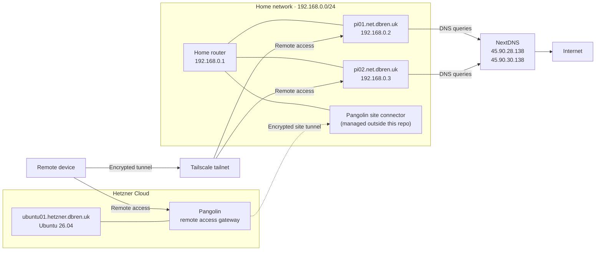

# :material-lan: Home and Cloud Network Architecture

This diagram shows the home network, its NextDNS and Tailscale integrations,
and the Hetzner Cloud VPS intended to host Pangolin.

See the [DNS documentation](dns.md) for details about NextDNS and its rewrite
records. [Tailscale](tailscale.md) provides encrypted remote access to the
Raspberry Pi devices from outside the home network.

The [Hetzner VPS](hetzner-vps.md) is the intended public host for
[Pangolin](pangolin.md), which provides access to selected services on remote
networks. The dotted connection shows the intended site tunnel; the site
connector and resource configuration are managed outside this repository.
